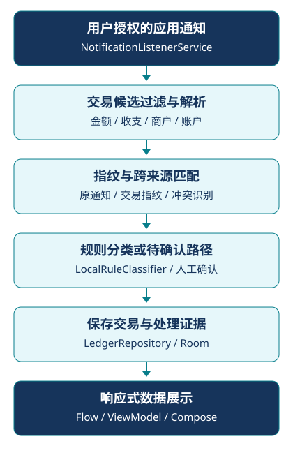

<p align="center"></p>

<h1 align="center">AutoLedgerCN</h1>

<p align="center">本地通知记账 · 从交易通知到可确认、可追溯的流水</p>

<p align="center">


</p>

Kotlin Android 应用，使用通知监听、规则解析与多层去重，把用户授权的交易通知保存为本地账本。技术重点是 Android 系统交互、数据持久化和歧义交易处理。开发使用 AI 辅助，保留真实源码与验证边界。

[运行与设备验收](docs/RUNNING.md) · [架构说明](docs/ARCHITECTURE.md) · [实际验证](VERIFICATION.md) · [隐私与资源](docs/PRIVACY_AND_ASSETS.md)

## 当前状态

已恢复工程结构并完成静态资源、引用、源码差异与隐私检查。**当前版本尚未重新构建或实机验收**；历史 Debug 成功日志不能替代本版本验证。仓库没有可验证的真实 App 截图，暂不展示界面图。

分类使用 `LocalRuleClassifier`；`AiClassifier` 仅保留接口，`NoopAiClassifier` 返回 null，未接入大模型或云 AI。没有后端服务或登录系统。

## 核心功能与工程难点

- **通知接入**：NotificationListenerService 接收用户所选应用的通知，过滤非交易候选并记录诊断；通知访问须用户授权

- **金额与字段解析**：提取金额、收支、商户、账户和时间；拒绝非有限、非正金额，隐藏金额或歧义通知进入待确认流程

- **多层去重**：原通知指纹、5分钟交易指纹与10分钟跨来源候选规则分别处理重复通知和多来源交易；冲突交由用户确认

- **本地持久化**：Room 实体/DAO/仓储保存流水、原通知、规则、待确认与诊断；Flow/ViewModel 驱动 Compose，DataStore 保存偏好

- **账本交互**：手工记录、流水查询、统计页面、预算参数、CSV 导入导出、监听应用管理和模拟通知

- **后台任务**：WorkManager 的 StatsRefreshWorker 当前仅查询交易，不代表完整后台统计计算

通知格式与商户描述并不统一，去重也不能仅依赖金额。工程保留匹配证据与人工确认路径；不能保证所有银行、电商或设备通知都正确解析。金额仍为 Double，舍入、并发去重及 Room 迁移需设备验证。

## 业务数据流

<p align="center"></p>

该图概括通知处理与数据展示，不表示每条通知均直接入账。实现入口：[通知服务](app/src/main/java/com/autoledgercn/service/AutoLedgerNotificationListener.kt)、[解析器](app/src/main/java/com/autoledgercn/domain/parser/NotificationParser.kt)、[去重引擎](app/src/main/java/com/autoledgercn/domain/dedup/DeduplicationEngine.kt)、[仓储](app/src/main/java/com/autoledgercn/data/repository/LedgerRepository.kt)。

## 本地运行

工具链保留历史配置：JDK17、SDK35、minSdk26、AGP8.7.3、Kotlin2.0.21、Gradle wrapper9.3.0。打开工程、配置本机 `local.properties` 后，按[运行说明](docs/RUNNING.md)在普通 PowerShell 或 Android Studio 构建并验收。本轮没有执行 Gradle 同步、构建或测试；当前工具链兼容性须看实际构建日志。

13个原JUnit文件及新增异常金额用例保留，均没有本轮执行通过记录。结构如下：

```text
app/src/main/java/com/autoledgercn/
├── service/       # 通知监听、后台任务
├── domain/        # 解析、去重、分类
├── data/          # Room、仓储、偏好
└── ui/            # Compose、ViewModel
app/src/main/res/  # Manifest引用的实际资源
app/src/test/      # 本地JUnit源码
```

## 隐私、素材与许可

应用没有 INTERNET 权限。原通知正文和交易记录仍属于敏感数据；演示请使用模拟通知或虚构数据。已禁用备份并补充排除规则，但未实测 OEM 云备份/迁移。导出 CSV 离开沙盒后需自行保管，不得提交真实账单、数据库或通知截图。

原角色图片未纳入，装饰矢量与本轮 Logo/徽章为自行编写的几何图形；内部历史主题标识保留以兼容已有偏好。

业务源码目前未设开放源代码 LICENSE，因此不展示 MIT 徽章。个人项目来源说明支持此次公开展示，但尚不足以完整确认借鉴内容的再许可权，不能据此强行将全部代码转为 MIT。Gradle wrapper 独立保留 Apache-2.0 许可；详见[第三方材料](THIRD_PARTY_NOTICES.md)。[公开文件清单](PUBLIC_FILES_MANIFEST.md)与[排除清单](EXCLUDED_FILES.md)记录文件范围。
